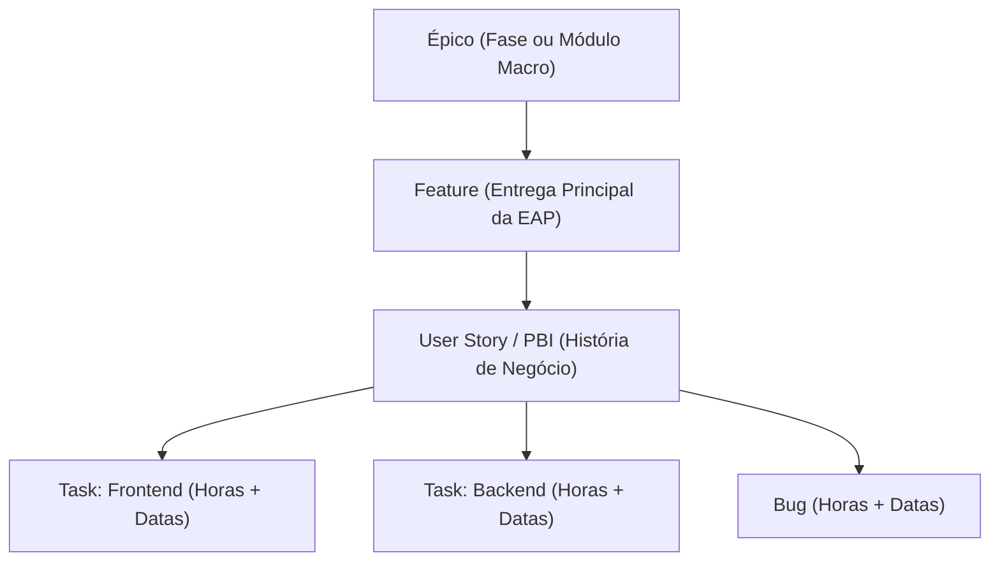
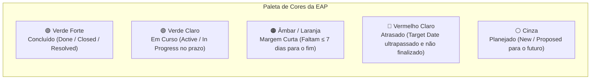

# Guia de Boas Práticas e Padrão de Uso do Azure DevOps
### Integração Oficial com o Dashboard Executivo & Cronograma EAP (ILC)

Este guia estabelece o padrão operacional para Product Owners (POs), Scrum Masters, Tech Leads, Gerentes de Projetos e Desenvolvedores cadastrarem e manterem seus itens de trabalho (**Work Items**) no Azure DevOps (`projetosmirassol1`), garantindo que o **Dashboard ILC** e o **Cronograma EAP (Gantt)** reflitam com 100% de precisão as datas, horas, status e progresso dos projetos.

---

## 1. Visão Geral da Integração

A plataforma do Dashboard sincroniza automaticamente com o Azure DevOps:
- **Sincronização Automática**: Ocorre a cada 30 minutos em segundo plano.
- **Sincronização Sob Demanda**: Pode ser disparada a qualquer momento na aba **Curadoria** (`Sincronizar Azure DevOps`).
- **O que a Plataforma Extrai**:
  - **Entregas da EAP**: Nomes das entregas, fases da EAP e datas início/fim.
  - **Esforço Real vs Planejado**: Horas estimadas (`Original Estimate`) e executadas (`Completed Work`).
  - **Progresso %**: Calculado a partir da conclusão das entregas e avanço do esforço.
  - **Indicadores de Prazo**: Concluído, Em Curso, Margem Curta (≤ 7 dias) e Atrasado.
  - **Responsáveis e Vínculos**: Quem lidera cada entrega e lista de tarefas filhas.

---

## 2. Estrutura Hierárquica Obrigatória (Work Item Hierarchy)

Para que o rollup de horas e a visualização do cronograma funcionem perfeitamente, a estrutura recomendada no Azure DevOps é:

### Regra de Vínculo (Relação `Parent`):
> [!IMPORTANT]
> **Vínculo Pai-Filho Obrigatório**: As tarefas técnicas (`Task` e `Bug`) **precisam estar vinculadas** à sua `User Story` ou `Feature` correspondente via relação **Parent** (`System.LinkTypes.Hierarchy-Reverse`).
> 
> **Como fazer no Azure DevOps**:
> 1. Na tela da Task/Bug, vá na seção **Related Work** ➔ **Add link** ➔ **Existing item**.
> 2. Selecione o tipo de link **Parent** e informe o ID da User Story ou Feature.
> 3. *Ou mais fácil:* Arraste e solte no menu **Backlogs** com a opção **Parents: Show** habilitada.

### O que acontece se o projeto não tiver Épicos e Features?
A plataforma possui inteligência de fallback em 3 níveis:
1. **Nível 1 (Ideal)**: Exibe **Features** e **Épicos** no Gantt e soma as horas de todas as User Stories e Tasks filhas.
2. **Nível 2 (Fallback Ágil)**: Se o projeto não utiliza Épicos/Features, a plataforma busca as **User Stories / PBIs** e monta a EAP com elas.
3. **Nível 3 (Fallback Técnico)**: Se o projeto utiliza apenas Tasks e Bugs soltos, a plataforma lista diretamente as Tasks como entregas.

---

## 3. Classificação Automática das 5 Etapas da EAP

No Dashboard executivo, o cronograma é organizado em 5 fases sequenciais oficiais:
1. **Fase 1: Planejamento**
2. **Fase 2: Desenvolvimento**
3. **Fase 3: Homologação**
4. **Fase 4: Treinamento**
5. **Fase 5: Operação Assistida**

A plataforma classifica o Work Item automaticamente analisando o **Título**, as **Tags** ou o **Nome da Iteração/Sprint**:

| Etapa da EAP | Palavras-Chave Identificadas no Azure DevOps | Exemplo de Título ou Tag |
| :--- | :--- | :--- |
| **1. Planejamento** | `ideacao`, `discovery`, `requisito`, `especificacao`, `concepcao`, `prototipo`, `fase 1`, `planejamento` | `[Discovery] Mapeamento de Requisitos` ou Tag `Planejamento` |
| **2. Desenvolvimento** | *(Fase Padrão)* — Qualquer item de construção de software, API, integração ou infraestrutura. | `Implementação da API de Pagamentos`, `Frontend Portal` |
| **3. Homologação** | `qa`, `qualidade`, `uat`, `e2e`, `teste`, `homologacao`, `fase 4`, `validacao` | `Homologação Integrada (UAT/E2E)` ou Tag `QA` |
| **4. Treinamento** | `treinamento`, `capacitacao`, `onboarding`, `workshop` | `Treinamento dos Operadores e Multiplicadores` |
| **5. Operação Assistida** | `operacao assistida`, `go-live`, `golive`, `sustentacao`, `fechamento`, `tep` | `Go-Live e Operação Assistida (30 dias)` |

> [!TIP]
> **Dica Prática**: Se o título da entrega for genérico, basta adicionar uma **Tag** no Azure DevOps (ex: `Homologação`, `Treinamento` ou `Operação Assistida`) para direcionar o card automaticamente para a linha correta da EAP!

---

## 4. Dicionário de Campos e Preenchimento Correto

### A. Para Entregas da EAP (`Epic`, `Feature` ou `User Story`)

| Campo no Azure DevOps | Nome Técnico da API | Importância | Como Preencher |
| :--- | :--- | :---: | :--- |
| **Title** | `System.Title` | **Crítico** | Nome objetivo da entrega (ex: *Módulo de Relatórios Financeiros*). Evite títulos vagos. |
| **Planned Start Date** | `Custom.PlannedStartDate` ou `StartDate` | **Crítico** | Data em que a entrega começa (ex: `2026-03-01`). *(Se vazio, a plataforma herda a menor data das tasks filhas)*. |
| **Target Date** | `Custom.TargetDate` ou `TargetDate` | **Crítico** | Data prevista de conclusão/entrega (ex: `2026-03-25`). *(Se vazio, herda a maior data das tasks filhas)*. |
| **Assigned To** | `System.AssignedTo` | **Alta** | Pessoa responsável por liderar a entrega (ex: PO ou Tech Lead). |
| **Iteration Path** | `System.IterationPath` | **Média** | Sprint/Ciclo correspondente (ex: `Projeto\Sprint 4`). |
| **State** | `System.State` | **Crítico** | `New`, `Active`, `Resolved` ou `Closed`. |

---

### B. Para Tarefas Técnicas de Execução (`Task` e `Bug`)

> [!CAUTION]
> **Horas de Esforço Devem Ser Lançadas nas Tasks!**
> Para evitar divergências de apontamento, as horas são calculadas a partir das tarefas técnicas e consolidadas no item pai.

| Campo no Azure DevOps | Nome Técnico da API | Importância | Como Preencher |
| :--- | :--- | :---: | :--- |
| **Original Estimate** | `Microsoft.VSTS.Scheduling.OriginalEstimate` | **Crítico** | Quantidade de horas **planejadas/estimadas** para a tarefa (ex: `8`, `16`, `40`). |
| **Completed Work** | `Microsoft.VSTS.Scheduling.CompletedWork` | **Crítico** | Quantidade de horas **já realizadas/executadas** (ex: `4`, `16`, `22`). |
| **Remaining Work** | `Microsoft.VSTS.Scheduling.RemainingWork` | Recomendado | Horas que ainda faltam para concluir a tarefa. |
| **Assigned To** | `System.AssignedTo` | **Crítico** | Desenvolvedor/Especialista responsável pela execução. |
| **Parent** | `System.LinkTypes.Hierarchy-Reverse` | **Crítico** | ID da User Story ou Feature à qual esta tarefa pertence. |
| **Planned Start Date** / **Target Date** | Datas de início e fim da tarefa | Recomendado | Usado no detalhamento da tarefa e no rollup quando o pai não tem data explícita. |

---

## 5. Padrão de Nomenclatura de Títulos (Clean Titles)

O Dashboard ILC conta com um algoritmo inteligente de limpeza de títulos para que os blocos da EAP fiquem limpos e fáceis de ler no padrão Monday / Asana. 

### O que o Dashboard limpa automaticamente:
- IDs iniciais: `#6943`
- Emojis decorativos: `🚀`, `📋`, `⚡`
- Tags de projeto entre colchetes: `[Épico 1]`, `[Frete Expresso]`, `[JD-PROMISS]`, `[MVP]`
- Prefixos de tipo: `Épico 1 -`, `Feature 2:`, `US 05 -`

### Exemplos de Aplicação:

| Como está no Azure DevOps | Como é exibido no Dashboard ILC | Avaliação |
| :--- | :--- | :---: |
| `#6943 [Épico 1] Fase de Ideação, Descoberta e Governança` | **Fase de Ideação, Descoberta e Governança** | ⭐ Excelente |
| `[Frete Expresso] Homologação Integrada (UAT/E2E) e Qualidade QA` | **Homologação Integrada (UAT/E2E) e Qualidade QA** | ⭐ Excelente |
| `Feature 03: Desenvolvimento do Módulo Financeiro` | **Desenvolvimento do Módulo Financeiro** | ⭐ Excelente |
| `Ajustes gerais` | **Ajustes gerais** | ⚠️ Muito vago |

---

## 6. Mapeamento de Cores e Prazos no Cronograma EAP

A plataforma avalia automaticamente o status de cada bloco com base no estado e na data de entrega (`Target Date`):

- **🟢 Concluído**: `State` = `Closed`, `Done` ou `Resolved`.
- **🟢 Em Curso**: `State` = `Active` ou `In Progress`, e o `Target Date` está a mais de 7 dias à frente.
- **🟠 Margem Curta**: O item está em andamento, mas faltam **7 dias corridos ou menos** para a data de entrega combinada.
- **🔴 Atrasado**: O `Target Date` já passou da data de hoje e o item ainda não foi concluído.
- **⚪ Planejado**: O item ainda está em `New` ou `Proposed`.

---

## 7. Como Auditar a Qualidade dos Dados (Botão "📋 Extrato Azure")

Para garantir que nenhum dado fique faltando, qualquer membro com acesso à plataforma pode auditar a saúde das informações do Azure DevOps:

1. Acesse o projeto no Dashboard e abra a visualização **Cronograma EAP**.
2. Clique no botão **`📋 Extrato Azure`** no cabeçalho.
3. O modal exibirá:
   - **Score de Conformidade Geral** (ex: `89% de dados preenchidos`).
   - Resumo por categoria: Épicos, Features, User Stories e Tasks.
   - Lista item a item com **indicação visual de pendências**:
     - ⚠️ *Data de Início não preenchida*
     - ⚠️ *Data de Fim não preenchida*
     - ⚠️ *Responsável não atribuído*
     - ⚠️ *Horas Planejadas zeradas (para Tasks)*

---

## 8. Checklist do PO / Scrum Master / Tech Lead

Antes de fechar o planejamento de uma sprint ou marco de entrega, verifique este checklist rápido:

- [ ] Toda `Feature` ou `User Story` possui uma data de início (`Planned Start Date`) e fim (`Target Date`).
- [ ] Toda entrega possui um responsável atribuído (`Assigned To`).
- [ ] As tarefas técnicas (`Task` e `Bug`) possuem **Original Estimate** preenchido com a estimativa em horas.
- [ ] As tarefas em andamento/concluídas possuem **Completed Work** preenchido com as horas apontadas.
- [ ] Todas as tarefas estão vinculadas ao seu item pai via relação **Parent**.
- [ ] Itens de homologação ou treinamento possuem termos chave no título ou a tag correspondente (`QA`, `Homologação`, `Treinamento`, `Operação Assistida`).
- [ ] O **Score de Conformidade** no extrato da plataforma está acima de 90%.

---

*Documento gerado pelo time de Engenharia e Governança do Dashboard ILC.*
